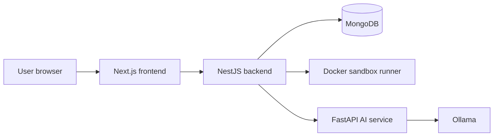

# Alga — AI-Assisted Competitive Programming Platform

**Alga** is a university team project for practicing algorithms and competitive programming. It combines a web interface, an online judge for Python/C++ submissions, user progress tracking, and an AI-powered learning assistant.

> **Project status:** Archived university project. Features and architecture below are based on the source code; the complete stack has not been independently verified to run in its current configuration. This is **not** a production-hardened deployment.

## Features

- User registration and authentication with JWT
- Problem catalog, search, tags, and difficulty filters
- Python and C++ code submissions with test-case evaluation and verdicts
- Isolated execution environment using Docker containers (with resource and network restrictions)
- AI-generated hints and feedback using a separate FastAPI service and Ollama
- Personalized problem recommendations, performance statistics, and leaderboard
- Admin routes for managing programming problems

## Tech stack

| Component | Technologies |
| --- | --- |
| Frontend | Next.js, React, TypeScript |
| Backend API | NestJS, TypeScript, Mongoose, JWT, Swagger |
| Database | MongoDB |
| AI service | Python, FastAPI, Ollama |
| Code execution | Docker sandbox images, Python, C++ |
| Orchestration | Docker Compose |

## Architecture



## Repository structure

```text
AlgaProject-main/
├── frontend/          # Next.js web application
├── backend/           # NestJS API, authorization, submissions, recommendations
├── ai-service/        # FastAPI service for LLM hints and feedback
├── docker/sandbox/    # Python and C++ sandbox Dockerfiles
├── docker-compose.yml
├── .env.example       # Example local environment values (no real secrets)
└── .gitignore
```

## Local development (Docker)

**Prerequisites:** Docker Desktop or Docker Engine with Compose. The provided Compose file is tailored to a Windows host with an Ollama directory in `%USERPROFILE%` and an NVIDIA GPU. Adapt the Ollama mount and GPU reservation for your machine. Do **not** deploy this configuration to the public internet without security review.

1. Download the source and open the repository directory.
2. Copy `.env.example` to `.env` and replace the example database password and JWT secret with your own strong values. Never commit `.env`.
3. Build the sandbox images (these are not built automatically by `docker compose up`):

   ```bash
   docker build -t alga-sandbox-python -f docker/sandbox/Dockerfile.python docker/sandbox
   docker build -t alga-sandbox-cpp -f docker/sandbox/Dockerfile.cpp docker/sandbox
   ```

4. Start the services from the repository root:

   ```bash
   docker compose up --build -d
   ```

5. Ensure the selected Ollama model is available:

   ```bash
   docker compose exec ollama ollama pull gemma3:4b
   ```

   If you change `OLLAMA_MODEL` in `.env`, pull that model instead.

6. Once services are healthy, try these addresses:

   - **Frontend:** http://localhost:3000
   - **Backend API:** http://localhost:4000
   - **Swagger docs:** http://localhost:4000/api/docs
   - **AI service:** http://localhost:8000/docs

> **Note:** These are the intended startup steps inferred from the configuration, not a verified end-to-end run. The sandbox depends on host Docker access, GPU settings may require adjustment, and an administrator account / example problems may need to be created before using every feature.

## Tests

Backend contains example Jest test files and scripts:

```bash
cd backend
npm ci
npm test
```

Tests have not been executed or independently validated for this archive.

## Security and deployment notes

This repository is a **learning / portfolio project**, not a secure public code-judging service as-is. In particular:

- The Compose configuration has insecure default credentials and exposes local infrastructure ports. Supply your own credentials and avoid exposing those services to the internet.
- The backend has access to `/var/run/docker.sock`; this grants broad control over the Docker host and requires a safer isolation design before deployment.
- Review API authorization and data exposure, including access to submitted code and problem test cases.
- Review and test sandbox isolation before accepting untrusted submissions from real users.

## Project background

Alga was developed collaboratively as a **university team project**. This repository presents the project and its technical structure without attributing the team's work to any one contributor.

## License

No license has been selected. Because this is a team project, agree on publication rights and an appropriate license with the other contributors before adding a license file.
